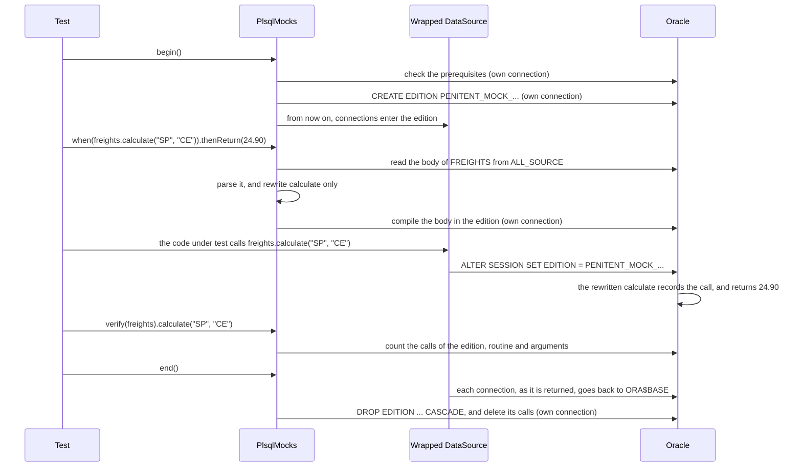

# 0001. Mocking PL/SQL in integration tests with editions

- **Status:** Accepted, 2026-11-11. The core, the JUnit 5 extension and the Spring Test support are implemented and
  measured on Oracle 23ai; the module's tests are skipped on other versions until they are measured.
- **Module:** `penitent-test`.

## Context

An application that calls PL/SQL often needs, in a test, a routine to return a fixed value or to fail: a freight
calculation, a call to an external system wrapped in a package, an error that is hard to provoke for real. The test
should still run against a real Oracle, with the real schema, the real SQL and the real PL/SQL around the call, because
that is where most of the behavior lives. A mock that lives only in Java misses exactly that: it cannot stand in for a
routine that other PL/SQL calls.

Oracle's edition-based redefinition (EBR) lets a session see its own version of a package body, while every other
session keeps seeing the real one. Oracle designed it to upgrade an application while it is online; using it to mock
PL/SQL in tests is, as far as we know, not an established practice, and this decision proposes it. A spike measured
that it works, as [Measured](#measured) shows. Penitent already knows, for each method of an interface, which routine
it calls, with its parameters and overload, from the dictionary, so the mock can be generated from the interface the
application already has, instead of written by hand.

## Decision

A new module, `penitent-test`, mocks a routine of a package in an integration test, in the style of Mockito:

<!-- snippet: untested -->
```java
CalculadoraFretes pkg = mocks.mock(CalculadoraFretes.class);

when(pkg.calculaFrete("SP", "CE")).thenReturn(new BigDecimal("24.90"));
when(pkg.calculaFrete("SP", "XX")).thenThrow(-20200, "Cannot calculate freight to XX");
when(() -> pkg.cotacao(eq("CE"), out(new BigDecimal("99.99"))));

BigDecimal value = service.freightBetween("SP", "CE");   // real code, real database

verify(pkg).calculaFrete("SP", "CE");
```

1. **The interface is the handle.** `mock(...)` returns a proxy that only records the call. The routine, its owner
   and its overload come from the same metadata a real call uses.
2. **Only the mocked subprogram changes.** The package body is read from `ALL_SOURCE` and parsed with
   [IslandSQL](https://github.com/IslandSQL/IslandSQL). The declare section and body of the mocked subprogram are
   replaced by generated code; its heading, every other subprogram, private ones included, and the package spec stay
   as the database has them. Declarations such as `%TYPE`, `SUBTYPE` and `DEFAULT` are kept verbatim.
3. **The generated code** records the call, then checks the stubs, the last one first, so that the last stub that
   matches wins, as in Mockito: a matching one returns its value, sets its `OUT` values or raises its error. No match
   is an error that names the routine and shows the arguments (strict). Other PL/SQL that calls
   the routine sees the mock too.
4. **One edition per test,** created before the test, so that a Spring test transaction opens its connection already
   in it, and dropped after the test. Each stub is compiled into the edition as soon as it is complete, on a connection
   of its own, since DDL commits.
5. **The application's connections enter the edition through its `DataSource`, wrapped in tests:** each connection
   handed out runs `ALTER SESSION SET EDITION` for the current test's edition, and goes back to `ORA$BASE` when it is
   closed.
6. **Prerequisites are explicit DDL,** shipped in the jar and in the documentation, for the user to apply as a
   migration, a Flyway callback or a container init script:
   - `penitent-mock-admin.sql`, for a DBA: `ENABLE EDITIONS FOR PACKAGE`, limited to packages so that the schema's
     tables and object types are left as they are, and `CREATE ANY EDITION` and `DROP ANY EDITION`;
   - `penitent-mock-schema.sql`, for the schema owner: the table `PENITENT_MOCK_CALLS` and the package `PENITENT_MOCK`,
     static, with an autonomous `record` and a `version`.

   The library never runs them by itself. It checks them, the version included, when a test begins, and fails with
   a message that lists everything missing and names the scripts. The schema reads its own state, without a DBA:
   `USER_EDITIONED_TYPES` for the editions, `SESSION_PRIVS` for the privileges. `PlsqlMocks.prepare(admin, owner,
   schema)` runs the same scripts, the first through a DBA's `DataSource` and the second as the schema, as a
   convenience for a disposable database such as Testcontainers; running it again is harmless.
7. **Support for JUnit 5 and Spring Test,** with the Spring support ordered before Spring's transaction listener.
   For JUnit 5, `PlsqlMockExtension`, registered with `@RegisterExtension` and a supplier of the wrapped
   `DataSource`, begins the test's edition before its `@BeforeEach` methods, so a stub can be made there, and ends it
   after its `@AfterEach` ones, whether the test passed or failed. A test can take its `PlsqlMocks` as a parameter.
   JUnit is an optional dependency of the module.

   For Spring, `@EnablePlsqlMocks` on the test class, with nothing else:

   <!-- snippet: untested -->
   ```java
   @SpringBootTest
   @EnablePlsqlMocks
   class FreightServiceTest {

       @Autowired PlsqlMocks mocks;   // one per context, a new edition per test

       @Test
       void calculates_freight() {
           when(mocks.mock(Freights.class).calculate("SP", "CE")).thenReturn(new BigDecimal("24.90"));
           // ...
       }
   }
   ```

   - A `ContextCustomizer`, found by Spring Test, wraps every `DataSource` bean of the context and adds the
     `PlsqlMocks` bean, on the `DataSource` that `@EnablePlsqlMocks(dataSource = ...)` names, or the only or primary
     one. Only the contexts of annotated classes change, so Spring caches them apart from the others.
   - A `TestExecutionListener` ordered just before Spring's transactional one begins the edition before the test
     transaction takes its connection, which then enters the edition as Oracle requires, and ends it after the
     transaction gave the connection back, so the edition can be dropped. Stubs compile on a connection of their own,
     so they never commit the test transaction.
   - The context is not refreshed for each test: the `DataSource` is wrapped once, when the context starts, and Spring
     caches the context as usual. Each test only creates and drops its edition. Classes annotated alike share one
     context; a class without the annotation gets another, since the annotation changes the context.
   - Spring is an optional dependency of the module.

### First version

| In | Later |
|---|---|
| functions and procedures of a package in the user's schema | routines outside a package, another schema, synonyms |
| scalars: numbers, text, dates, timestamps, `null`, and `BOOLEAN` on 23ai | object types, collections, cursors |
| return values, scalar `OUT`, application and predefined errors | `IN OUT`, consecutive returns |
| matchers: exact value, `eq`, `any`, `isNull` | other matchers |
| strict | spy: the real logic when no stub matches |
| JUnit 5, Spring Test | mocking SQL views, which editions can also do |

### How a mock behaves

What a test can count on, each case backed by a test of the module:

| Case | Behavior |
|---|---|
| The other routines of the package, public and private, and the other overloads of the stubbed one | stay real: only the stubbed subprogram is rewritten, and the rest of the body is compiled as written |
| A real routine that calls a stubbed routine **of the same package** | gets the mock: the whole body is compiled in the test's edition, so the call finds the rewritten version |
| A routine **of another package** that calls the stubbed routine | gets the mock, for the same reason |
| The stubbed routine itself | runs no real code: it records the call, checks the stubs, and returns or raises. What its real code called is no longer called by it |
| A session outside the test's edition, at the same moment | sees the real routine |
| `verify` of a routine with no stub in the test | refused: only a stubbed routine records its calls, so counting the calls of a real one would always give zero, and a `never()` would pass whatever happened |
| A call on the mock itself, neither stubbed nor verified | refused, at the next call on a mock or at `end()`: the mock only records, unlike a Mockito one, so such a call ran nothing and returned nothing, most likely expecting the stub's answer or the routine to run |

And what it cannot do, in the first version:

- **An argument of an object type, a collection or a record is matched with `any()` only.** No PL/SQL literal
  stands for its value, and `JSON_ARRAY` does not take it, so a recorded call holds `"(not recorded)"` in its place,
  keeping the position of the others; another matcher on it is refused before compiling. A stub cannot return one
  yet, nor set it as an `OUT`.
- **A `%ROWTYPE` argument cannot be bound once a stub recompiled its package,** in the same test: the driver fails to
  build the type's descriptor (`ORA-17060`), even with the spec recompiled too (measured; issue #31).
- **A private routine, declared only in the body, cannot be stubbed.** A stub starts from a method of the interface,
  and a private routine has none. It stays real, and a stubbed routine that called it no longer does.
- **A wrapped body cannot be parsed,** so nothing in that package can be stubbed; the library refuses it.
- **The application and the mocks share one wrapped `DataSource`.** The test's edition is kept in the wrapped
  object, so the code under test, whatever it uses (Penitent's interfaces, a `JdbcTemplate`, JPA), has to take its
  connections from the same object given to `PlsqlMocks.on`. Wrapping the same pool again gives the same object, so
  that case cannot go wrong; but another pool of the same database, wrapped apart, does not follow the test's edition.
  Keeping the edition in one place for the whole JVM would lift this, since only one test mocks at a time, but it
  would also send a pool of another database into an edition that does not exist there: it waits for a real case.
- **One mocks on a database at a time.** Mocks that begin while others, in the same JVM, are on in the same database,
  such as through a second pool of it, are refused with a clear message, and the edition in use is left alone. An
  edition that the database has and this JVM does not, left by a run that died, is dropped by the next `begin()`.
  With Spring, the `PlsqlMocks` bean works on one `DataSource`: the others of the context are wrapped too, but their
  connections do not enter the test's edition.
- **Only the connections of the wrapped `DataSource` enter the edition,** and only those taken after `begin()`. A
  connection taken before, and kept, stays where it was, and keeps seeing the real routines.
- **A connection taken in the test and still open at `end()`** keeps the edition in use, and dropping it fails, with a
  message that says so.
- **In Spring, the `DataSource` bean is no longer of the pool's type.** Wrapping it changes its class, so a bean that
  injects the pool by its concrete type, such as `HikariDataSource`, no longer finds it (measured with Spring Boot);
  injecting `DataSource`, and `unwrap(HikariDataSource.class)`, still work, and so do Spring Boot's `JdbcTemplate`
  and transaction manager.
- **The pool needs a connection to spare.** Creating and dropping the edition, compiling a stub, reading a routine's
  signature and counting calls each run on a connection of the mocks' own, outside any transaction of the test, since
  DDL commits. A test that holds every connection of the pool, such as a single-connection pool with a Spring test
  transaction open, leaves none: the mocks then fail with a message that asks for one connection more than the test
  uses at once, instead of a bare timeout of the pool.
- **Stub a package before the test uses it.** Each stub recompiles the package body in the test's edition, and Oracle
  discards the package's state in every session that had already run it: the next call there fails once with
  `ORA-04068: existing state of packages has been discarded`, and the call after it sees the new stub (measured). A
  test that makes its stubs first and then acts, the usual arrange, act and assert, never meets it. A stub made after
  the package was used, such as a second stub in the middle of a test, does. Two ways around it are open, below.

## How the pieces fit together

### The pieces

| Piece | Where it lives | What it is for |
|---|---|---|
| The table `PENITENT_MOCK_CALLS` | the schema, created once by `penitent-mock-schema.sql` | one row per call to a stubbed routine: the edition, the routine and the arguments, as JSON |
| The package `PENITENT_MOCK` | the schema, created once by the same script | `record` writes a call to the table, in a transaction of its own; `version` tells which version of the script is applied |
| The test's edition | the database, created before the test and dropped after it | holds the rewritten package bodies, which only sessions in the edition see |
| The rewritten body | the test's edition | the package's own body, with the stubbed routine replaced by generated code |
| The wrapped `DataSource` | the application's tests | moves each connection it hands out into the test's edition, and back when it is returned |
| `PlsqlMocks` | the test | creates and drops the edition, compiles the stubs, and counts the calls for `verify` |

### A test, step by step

The first mock of the Testing page, from the beginning of the test to its end. "Own connection" is one the mocks take
for themselves, outside any transaction of the test, since DDL commits:



1. **`begin()`** checks the prerequisites, drops an edition a run that died left behind, and creates the test's
   edition. From then on, the wrapped `DataSource` puts each connection it hands out in it.
2. **`mock(...)`** gives a proxy that only records the calls made on it, as Mockito's does.
3. **`when(...).thenReturn(...)`** takes the call just recorded: the method gives the routine, through the same
   resolution a real call uses, and the arguments give the condition. The library reads the package body from
   `ALL_SOURCE`, outside the edition, so it is always the real one, rewrites the stubbed routine, and compiles the
   body in the test's edition. Every stub of the package so far goes into that compilation.
4. **The code under test** calls the routine as always. Its connection is in the edition, so Oracle runs the
   rewritten body: the generated code records the call through `PENITENT_MOCK.record`, then answers as stubbed.
   Other PL/SQL that calls the routine, in a session in the edition, runs the same code.
5. **`verify(...)`** counts the rows of `PENITENT_MOCK_CALLS` for the test's edition, the routine and the arguments.
6. **`end()`** drops the edition, with every body compiled in it, and deletes its calls. The connections went back to
   `ORA$BASE` as they were returned, which is what lets the edition be dropped.

### The PL/SQL generated for a stub

For `when(freights.calculate("SP", "CE")).thenReturn(new BigDecimal("24.90"))`, the routine `calculate` of the body
becomes this, compiled in the test's edition (shown as generated; a test of the module checks it):

```sql
FUNCTION calculate(p_origin freight_item.uf%TYPE, p_destination VARCHAR2 DEFAULT 'SP') RETURN money IS
    l_penitent_args VARCHAR2(4000);
  BEGIN
    SELECT JSON_ARRAY(P_ORIGIN, P_DESTINATION NULL ON NULL) INTO l_penitent_args FROM DUAL;
    PENITENT_MOCK.record('PLSQL_TEST.FREIGHTS.CALCULATE(P_ORIGIN,P_DESTINATION)', l_penitent_args);
    IF P_ORIGIN = 'SP' AND P_DESTINATION = 'CE' THEN
      RETURN 24.90;
    END IF;
    RAISE_APPLICATION_ERROR(-20999, 'PLSQL_TEST.FREIGHTS.CALCULATE: no stub matches the arguments ' || l_penitent_args);
  END calculate;
```

- **The heading is the body's own,** as written, so `%TYPE`, the `SUBTYPE` `money` and the `DEFAULT` are kept.
- **The arguments are recorded first,** as a JSON array of the `IN` parameters, with the routine and its parameter
  names, which tell overloads apart.
- **Each stub is an `IF`,** the last stub made first, so that the last one that matches wins. A matcher such as
  `any()` adds no condition; `isNull()` adds `IS NULL`. A second stub of the routine, for the same arguments or for
  others, adds an `IF` before this one and recompiles the body: stubs of different arguments answer each their own,
  and a later stub of the same arguments wins over an earlier one, since it is checked first (measured). A second
  answer given on the same stub, such as `thenThrow` after `thenReturn`, replaces the first one's `IF`.
- **No stub that matches** raises `ORA-20999`, with the arguments, so a missing stub never passes unnoticed.
- **The routine's real code is gone,** in this edition: what it called, it no longer calls. Every other routine of
  the body stays as written.

### What `verify` reads

After the call, the table holds one row for it:

| `EDITION_NAME` | `ROUTINE` | `ARGS` |
|---|---|---|
| `PENITENT_MOCK_5F2A91C3D4E6` | `PLSQL_TEST.FREIGHTS.CALCULATE(P_ORIGIN,P_DESTINATION)` | `["SP","CE"]` |

`verify(freights).calculate("SP", "CE")` counts the rows that match, with each argument read back from the JSON with
the type of its parameter, and fails unless the count is the one expected:

```sql
SELECT COUNT(*) FROM PENITENT_MOCK_CALLS
 WHERE EDITION_NAME = ? AND ROUTINE = ?
   AND JSON_VALUE(ARGS, '$[0]' RETURNING VARCHAR2(4000)) = 'SP'
   AND JSON_VALUE(ARGS, '$[1]' RETURNING VARCHAR2(4000)) = 'CE'
```

Only a stubbed routine records its calls, which is why `verify` refuses a routine with no stub in the test.

## Measured

A spike, on Oracle 23ai (`gvenzl/oracle-free:23.26.3`), with a package whose spec uses `%TYPE`, a `SUBTYPE`, a
`DEFAULT`, an overload, an `OUT` parameter, package state and a private function, and a second package calling the
first:

| What | Result |
|---|---|
| a stubbed return, error, `null` argument and `OUT` value | as stubbed |
| arguments with no stub | a clear error naming the routine |
| the overload, the private function and the other routines | still the real ones |
| another package calling the mocked routine | sees the mock |
| the same package, at the same time, outside the edition | still the real one |
| `verify`, through the calls table | every call, including the one made from PL/SQL |
| package state used before entering the edition | no `ORA-04068` |
| two tests in a row, each with its own edition | both pass, and nothing is left behind |
| creating, compiling into and dropping an edition | 5 to 22 ms, about 10 ms and about 15 ms |
| parsing a body with IslandSQL | about 830 ms the first time, while ANTLR warms up, then about 10 ms |

## Alternatives considered

- **A repository of its own, named Placebo.** It would give the module an identity and releases of its own, but the
  module relies on Penitent's internals (how a method resolves to a routine, the views of an interface), which would
  have to become public and stable API, and every change across both would take a release of each. While the module
  grows, it stays in this repository as `penitent-test`; it can be split out, under that name, when it outgrows it.

- **Mocks in Java only, with Mockito on the interface.** It already works, needs nothing in the database and suits a
  unit test. It cannot reach a routine that PL/SQL calls, nor exercise the SQL around the call, which is what this
  module is for.
- **Generating the body from `ALL_ARGUMENTS`.** The dictionary resolves `%TYPE` and `SUBTYPE` to their base types, and
  a body whose heading does not match the spec does not compile (`PLS-00323`, measured). Parsing the source keeps the
  declarations as written.
- **Replacing the body in place, without an edition, and restoring it afterwards.** Every other session would see the
  mock, compiling waits for sessions running the package (3.5 s measured), and a test that dies leaves the mock in
  place of the real body.
- **A mock schema, switched with `CURRENT_SCHEMA`.** PL/SQL in the real schema keeps calling the real package, and
  everything else referenced without a schema has to exist in the mock one.
- **Putting the connections in the edition without wrapping the `DataSource`.** An edition is per session, and a
  pool reuses its sessions from test to test, so each connection has to enter the test's edition when it is handed
  out, and leave it when it is given back, or the edition could not be dropped (`ORA-38805`) and the next test would
  find the session in the previous one. The connection property `oracle.jdbc.editionName` applies only when a
  connection is opened, as do a logon trigger and an edition per service; `ALTER DATABASE DEFAULT EDITION` needs a DBA
  and changes the whole database; switching only the test transaction's connection leaves out every call made on
  another connection. Wrapping costs one `ALTER SESSION` per connection handed out, and only in tests.
- **A data-driven body, compiled once and reading its stubs from a table.** It avoids recompiling per stub, but every
  value then has to round-trip through a table with its type. Recompiling costs about 10 ms, so it is not needed now.

## Consequences

- **Tests that mock run one at a time on a database.** An edition can have only one child (`ORA-38807`), so two
  tests cannot each have one at the same time.
- **`ENABLE EDITIONS` cannot be undone.** It belongs on a test database only, which is why it is explicit DDL and never
  run by the library on its own.
- **A wrapped body cannot be parsed,** so it cannot be mocked; the library refuses it with a clear error.
- **The schema holds two objects of the library,** the calls table and the `PENITENT_MOCK` package, versioned so that
  an outdated schema is reported before a test fails in an obscure way.
- **IslandSQL and the ANTLR runtime** become dependencies of `penitent-test` only. The core stays free of them.
- **`penitent-test` is for tests only,** declared with `<scope>test</scope>`, and never belongs in production code:
  it needs `ENABLE EDITIONS`, which cannot be undone, and privileges a production schema should not have
  (`CREATE ANY EDITION`, `DROP ANY EDITION`); it runs DDL while it works, creating editions, compiling bodies and
  dropping them; and it records each mocked call in a table. Outside automated tests, it fits only a disposable
  database, such as a development or QA one where a package that reaches an external system is replaced while
  someone explores the application by hand.
- **JUnit and Spring are optional dependencies of `penitent-test`,** so a project without them does not get them, and
  never loads the classes that need them: the JUnit 5 extension and the `mock.spring` package. Two reasons. Many
  projects test without JUnit 5's Jupiter, especially around legacy PL/SQL: JUnit 4, TestNG, Spock, Cucumber or
  Kotest, and they use `PlsqlMocks` directly, with `begin()` and `end()` in their own hooks. And versions have to
  agree: JUnit's platform and Jupiter must be of the same version, and `spring-test` must match the application's
  Spring, so a version brought in by this module could break the tests of a project on another one. As optional
  dependencies, each project uses its own. The cost is that the JUnit 5 extension, used without JUnit 5, fails with
  `NoClassDefFoundError`, as expected. The build runs the tests of the core and of the extension a second time with
  Spring off the classpath, so that the core cannot come to need it unnoticed.

## Open questions

- **Preparing the schema from the annotation, `@EnablePlsqlMocks(prepare = true)`.** Today the library never applies
  the prerequisites by itself: `begin()` only checks them, and a test calls `PlsqlMocks.prepare` once, explicitly,
  right after a disposable database starts. An attribute could do it for Spring tests, when the context starts.
  - **In favor:** nothing to write besides the annotation, and no place to look for where the database is ready,
    which is the part of the setup most often done wrong; it suits a disposable database, such as one of
    Testcontainers, where it would run once per context and harmlessly again.
  - **Against:** `ENABLE EDITIONS` cannot be undone, and an attribute hides that behind a word, where a call in the
    code is visible in review; applied by mistake to a shared or long-lived database, it changes that schema for
    good. It also needs a DBA's `DataSource`, which a Spring test does not usually have as a bean: the attribute
    would have to name one, or the credentials would have to come from properties, which is more setup, not less.
  - **Care it would need:** false by default; refusing to run when the schema's prerequisites are already there but
    of another version, rather than changing them silently; refusing a database that does not look disposable, if
    there is a reliable way to tell; and a log line, at warning level, each time it applies the admin script.
  - **For now:** the explicit call, until a real case shows that the annotation pays for what it hides.

- **Several pools of the same database sharing the mocks.** One edition, followed by every pool the test declares:
  `@EnablePlsqlMocks(dataSource = {"main", "reports"})`, or `mocks.include(reportsDataSource)` inside a test. The
  library would check that they reach the same database, by its `DB_UNIQUE_NAME` and `CON_NAME`, and a pool of
  another user of that database would need `GRANT USE ON EDITION`, since the edition belongs to the user who created
  it. Pools of different databases need no sharing: each database has mocks and an edition of its own.

- **A stub after the package was used,** which now fails the next call once with `ORA-04068`, as recorded above. Two
  options, either of which may be adopted, documented with it:
  - **B. Retry the call once, in tests only.** The wrapped `DataSource` wraps the statements of its connections too,
    and runs a call again once when it fails with `ORA-04068`: Oracle has already reset the package's state, so the
    second run works. It covers Penitent, a `JdbcTemplate` and any other JDBC, without the test doing anything. The
    cost is that it hides what happened: the package's state was reset, and a test that relies on that state, such as
    a counter in a package variable, sees it start over without a word. It would need to say so, at least in a log.
  - **C. A data-driven body.** The first time a package is mocked in a test, every routine of its spec is rewritten at
    once to look up its stubs in a table, and, with no stub that matches, to run its real code, kept as a nested
    block. Every later stub is a row in that table, not a compilation: no `ORA-04068`, no connection of its own for
    each stub, and no implicit commit. It also gives spy mode almost for free. The cost is the largest of all: the
    values travel through the table with their types, as JSON read back with `JSON_VALUE ... RETURNING`, and every
    routine of the package is rewritten, not only the stubbed ones. It is the alternative this decision first set
    aside as more than the first version needs.

- **Mocking more than packages.** In legacy schemas, PL/SQL is often coupled to other objects through the database:
  views, standalone functions and procedures, synonyms, triggers, object types. Editions can redefine all of them, so
  the mocks are meant to grow beyond packages, and `ENABLE EDITIONS FOR PACKAGE` in the admin script will widen with
  them. Object types need care: enabling editions for a type that a table uses fails (`ORA-38819`), and forcing it
  leaves the table invalid, as an earlier measurement showed.

- Oracle 21c and 19c, including whether `ADMIN` can enable editions on the Autonomous Database image used for 19c.
- Spy mode: running the original body, as a nested block, when no stub matches.
- Packages in another schema, and how much privilege that asks for.
